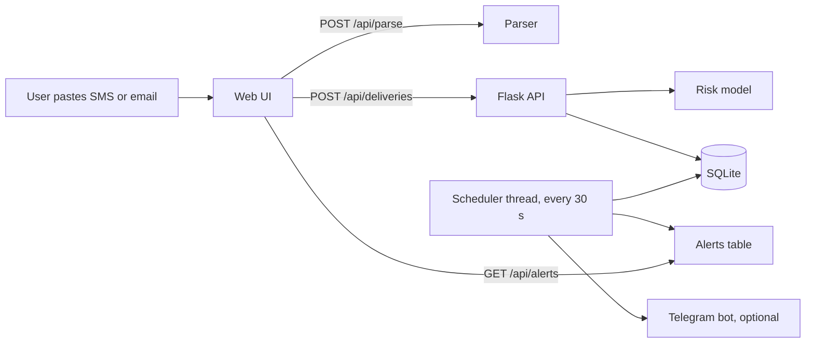

# Doorstep

**An AI-powered delivery notification system that reads delivery messages, predicts delay risk, and alerts users in time to receive their packages.**

   

## Problem
Delivery apps give wide time windows such as "between 2 PM and 6 PM". People miss deliveries because they don't know when the courier is close, aren't at the door, or don't have the OTP ready. A missed delivery means a failed attempt, a reschedule and wasted time.

## Solution
Doorstep takes the delivery SMS or email, extracts the details, estimates how likely the delivery is to be delayed, and warns the user twice: in the morning ("delivery today") and shortly before the window starts ("get ready").

## Features
- **Message understanding:** extracts courier, item, date, time window, OTP and delay status from pasted text.
- **Delay-risk prediction:** a scikit-learn model gives a Low / Medium / High risk with plain-language reasons.
- **Smart reminders:** a morning-of alert plus a configurable alert (15 min to 2 h) before the window starts.
- **Browser notifications** and optional **Telegram alerts** that work even when the page is closed.
- **Readiness checklist, OTP display and countdown** for each delivery.
- Data stored in SQLite; REST API; no external services required.

## Screenshots
Add screenshots to `docs/screenshots/` and link them here:

``

## How it works

More detail in [docs/ARCHITECTURE.md](docs/ARCHITECTURE.md).

## Tech stack
Python, Flask, SQLite, scikit-learn, pandas, NumPy, joblib, HTML/CSS/JavaScript, Notification API, Telegram Bot API.

## Project structure
```
doorstep/
├── app.py                  Flask server: web page, REST API, background alert scheduler
├── ml.py                   synthetic data, model training and comparison, prediction, explanations
├── parser.py               message parser (regex baseline)
├── evaluate_parser.py      measures parser accuracy on labelled messages
├── static/index.html       web interface
├── data/labeled_messages.json   hand-labelled messages for evaluation
├── tests/                  unit tests for the parser and the model
├── docs/                   architecture notes, report outline, screenshots
├── requirements.txt
├── .env.example            template for Telegram settings
├── .gitignore
└── LICENSE
```

## Installation
```bash
git clone https://github.com/YOUR-USERNAME/doorstep.git
cd doorstep
python -m venv venv
venv\Scripts\activate          # Windows      (Mac/Linux: source venv/bin/activate)
pip install -r requirements.txt
python app.py
```
Open **http://127.0.0.1:5000**. The first run trains the model and prints F1 scores and confusion matrices.

## Usage
1. Paste a delivery message and click **Read message** (or use **Use a sample**).
2. Check the filled fields and click **Add delivery**.
3. Choose how early to be warned, and allow browser notifications.
4. Doorstep shows the risk, OTP and countdown, and alerts you before the window starts.

### Optional: Telegram alerts
Create a bot with @BotFather, send it a message, get your chat id from `https://api.telegram.org/bot<TOKEN>/getUpdates`, then set `TELEGRAM_TOKEN` and `TELEGRAM_CHAT_ID` (see `.env.example`) before running `python app.py`.

## API
| Method | Endpoint | Purpose |
|---|---|---|
| POST | `/api/parse` | Extract fields from message text |
| GET | `/api/deliveries` | List deliveries with risk and reasons |
| POST | `/api/deliveries` | Add a delivery (risk is predicted on save) |
| POST | `/api/deliveries/<id>/done` | Mark received |
| DELETE | `/api/deliveries/<id>` | Remove |
| GET / POST | `/api/settings` | Read or set warning lead time |
| GET | `/api/alerts` | Unseen alerts (polled by the browser) |

## Machine learning
- **Task:** binary classification, will this delivery be delayed?
- **Features:** courier, weekday, start hour, window length, rainfall.
- **Models compared:** logistic regression and random forest (class-balanced). The better F1 is saved.
- **Data:** currently simulated (`ml.make_synthetic`). Replace it with real logged deliveries to improve accuracy.
- **Results:** run `python ml.py` for the confusion matrix and F1 of each model, and record them here.

| Model | F1 (delayed class) |
|---|---|
| Logistic regression | _fill in from your run_ |
| Random forest | _fill in from your run_ |

## Testing
```bash
python -m unittest discover -s tests -t .
python evaluate_parser.py
```

## Limitations
- The risk model is trained on simulated data, so its scores show the method, not real courier performance.
- The parser uses regular expressions and is tuned to common English message formats.
- Alerts need the server to be running. Browser notifications need the page open.

## Roadmap
- Replace the regex parser with spaCy NER or DistilBERT and compare F1.
- Train on real delivery history, pincode and live weather.
- Read SMS automatically on Android; push notifications through Firebase.
- Alert a family member through WhatsApp or Telegram; "who's home" sharing.
- User accounts and a hosted deployment.

## Author
Samiksha Krishnan, B.Tech CSE (2nd year).

## License
MIT, see [LICENSE](LICENSE).
